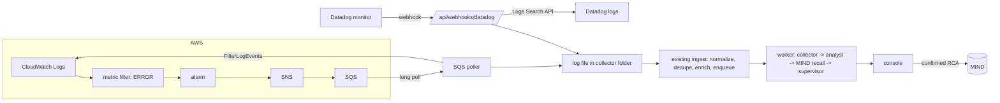

# OnCallAI live demo: real alerts in, MIND memory out

## What runs

`./scripts/start.sh` sets up a virtualenv, runs the tests, and starts one process on http://localhost:8787 with:

- a product page at `/` and the console at `/console`
- the existing runner pipeline in a worker thread (collector, analyst, MIND recall, supervisor)
- a CloudWatch-via-SQS poller, when `CW_SQS_QUEUE_URL` is set
- a Datadog webhook receiver at `POST /api/webhooks/datadog`



## Why CloudWatch -> SNS -> SQS

- CloudWatch alarms can only notify SNS. SNS can fan out to SQS.
- OnCallAI pulls from SQS. No public URL, works from a laptop.
- A message is deleted only after the incident and its logs are stored. If OnCallAI is down, alarms wait in the queue. A bad message is left for redelivery.
- The SNS message is the same alarm JSON your existing `alert_normalizer.py` already parses. No new incident format.
- The alarm's description carries routing hints: `{"oncallai": {"service": ..., "environment": ..., "log_groups": [...]}}`. That tells OnCallAI which log groups to read, including the dependency's.

## Run it

Offline (no AWS, simulated MIND):

```bash
python3 -m app.web.server --simulate-mind
# open http://localhost:8787
# click "1 Store past incidents", then "2 Replay CloudWatch alarm"
```

The replay feeds a recorded SNS->SQS message through the real `CloudWatchSqsSource` code with in-memory SQS and Logs clients.

Real AWS (free tier):

```bash
pip install boto3
aws configure                       # or any credentials with logs, cloudwatch, sns, sqs
bash scripts/aws_demo_setup.sh      # prints the export lines
export AWS_REGION=us-east-1 CW_SQS_QUEUE_URL=https://sqs....
python3 -m app.web.server --simulate-mind
python3 scripts/aws_emit_logs.py    # in another terminal; alarm fires 1 to 3 minutes later
bash scripts/aws_demo_teardown.sh   # when done
```

Real MIND on top: replace `--simulate-mind` with `MIND_ENABLED=true MIND_API_KEY=mind_xxx`.

Datadog:

1. Integrations -> Webhooks -> New. URL `https://<public-host>/api/webhooks/datadog`. Datadog needs a public URL, so use a tunnel such as ngrok or cloudflared for a laptop.
2. Custom header `{"X-OnCallAI-Token": "<DATADOG_WEBHOOK_TOKEN>"}`.
3. Payload:
   ```json
   {"alert_id": "$ALERT_ID", "title": "$EVENT_TITLE", "transition": "$ALERT_TRANSITION",
    "priority": "$ALERT_PRIORITY", "message": "$TEXT_ONLY_MSG", "date": "$DATE",
    "tags": "$TAGS", "query": "$ALERT_QUERY", "link": "$LINK"}
   ```
4. Put `@webhook-<name>` in a monitor message. Tag monitors with `service:` and `env:`.
5. Optional: `DD_API_KEY` and `DD_APP_KEY` (with `logs_read_data`) so OnCallAI pulls the logs via `POST /api/v2/logs/events/search`.

## Code review against the official MIND repo (theastraway/mind-mcp-server v0.32.1)

Checked every call in `app/memory/mind_client.py` against `dist/mind-client.js`:

| Check | Result |
|---|---|
| Routes: query, entries create/search/delete, graph | Match |
| Auth header `X-API-Key: mind_...` (REST) | Match. Remote MCP uses `Authorization: Bearer`, which we do not call. |
| `entries/search?query=&limit=` param names | Match |
| Response fields `response`, `sources: string[]`, `entry_id`/`id` | Match |
| Base URL `https://www.m-i-n-d.ai` (README says use `www`) | Match |
| Private writes only (`entry`, never `feed_post`) | Match |

Bugs found and fixed:

1. **Web-edge blocks.** MIND's edge returns an HTML 403/429/503 when a body looks like SQL, path traversal or shell. Incident logs look like that all the time. The official client retries gzipped. Ours gave up and fell back every time. Now it retries gzipped. Test: `test_edge_block_is_retried_gzipped`.
2. **Memory could still break triage.** Entity extraction ran outside the try. Now the analyst wraps the whole memory step. Test: `test_unexpected_memory_error_does_not_break_triage`.
3. `.env` was not loaded before MIND settings were read. Fixed.
4. Ledger SQLite connections were never closed. Fixed.
5. Entries are now tagged with their memory key, which gives search a second way to find them for dedupe.

Found while demoing, outside MIND:

6. The existing analyst called a connection-pool incident "DB pod crashed / not ready" because its example matched "connection". Added a pool-exhaustion rule.

Still noisy, left as is: the analyst appends fixes from loosely matched examples ("Add null checks") to every report. That is existing behaviour, worth tightening before a real demo.

## Design

One theme, fog and sodium, used on both pages. Each accent means one thing and never swaps roles:
petrol `#14323C` for text and structure, sodium `#E3962B` for live or alerting, tide `#2B8A78` for resolved, iris `#5459C9` for memory from MIND.
Type is IBM Plex Sans Condensed for service names and headings, Plex Sans for body, Plex Mono only for logs and memory keys. Fonts ship in `app/web/static/fonts` (SIL Open Font License), so the demo looks the same offline.
The memory graph (`app/web/static/graph.js`) is the one bold element: solid iris edges are past incidents today's logs back up, dashed edges are reference only.
