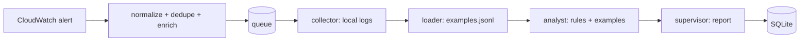
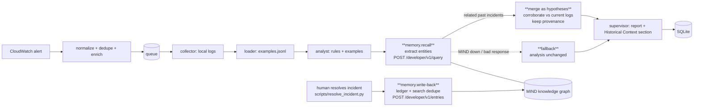

# MIND as persistent incident memory for OnCallAI

All incidents here are synthetic. No Nextiva or Oracle data.

## 0. What OnCallAI looked like before

| Layer | Where | What it does |
|---|---|---|
| Alert intake | `app/middleware/alert_ingest.py`, `alert_normalizer.py`, `cloudwatch_boto.py` | Normalizes CloudWatch alarms, dedupes by `dedupe_key`, enriches from `service_catalog.json`, enqueues |
| Queue + worker | `app/runner.py`, `incident_queue` table | Claims incidents, retries transient errors, dead-letters terminal ones |
| Collector | `app/agents/collector_agent.py`, `log_collection.py` | Picks a log folder (db / infra / web) by keywords, ranks files, returns snippets |
| Retrieval ("RAG") | `app/rag/loader.py`, `examples.jsonl` | Regex + token overlap over 3 hand-written examples. Not embeddings on the Python side. The hosted JS path uses Gemini embeddings + Supabase pgvector. |
| Triage / RCA | `app/agents/analyst_agent.py`, `app/rag/confidence.py` | Rule match first, else best retrieved example, then calibrated confidence |
| Supervisor | `app/agents/supervisor.py` | Builds the markdown + JSON report, escalation guidance, finalizes in one transaction |
| State | `app/db/dal.py`, SQLite | incidents, agent_steps timeline, reports, queue |
| Tests | `tests/` | 43 unittest cases, all passing before this change |

## 1. Architecture before vs after

Before:



After (new pieces in bold boxes, everything else unchanged):



New code lives in `app/memory/`. Existing files touched: `analyst_agent.py` (+7 lines), `supervisor.py` (+16 lines), `.env.example`, `Makefile`. Off by default: nothing changes until `MIND_ENABLED=true` and `MIND_API_KEY` are set.

## 2. Every MIND operation used

Source of truth: the official `@astramindapp/mcp-server` package v0.32.1 (`dist/mind-client.js`, `dist/server.js`). Each MCP tool wraps one REST route on `https://www.m-i-n-d.ai`, authenticated with `X-API-Key: mind_...`.

| Our call | REST route | MCP tool equivalent | Why we use it |
|---|---|---|---|
| `MindClient.query` | `POST /developer/v1/query` with `query`, `mode`, `retrieve_only=true`, `max_context_tokens` | `mind_query` | Recall related incidents. `retrieve_only=true` returns raw graph context, uses no MIND LLM, costs 0 credits. |
| `MindClient.create_entry` | `POST /developer/v1/entries` with `title`, `content`, `tags`, `folder` | `mind_remember` action=create, type=entry | Write the confirmed RCA. Entries are private. We never use `feed_post`, which is public. |
| `MindClient.search_entries` | `GET /developer/v1/entries/search?query=&limit=` | `mind_remember` action=search | Duplicate check before writing, and hydrating a record when a graph mode returns only its key |
| `MindClient.delete_entry` | `DELETE /developer/v1/entries/{id}` | `mind_remember` action=delete | Demo cleanup only |
| `MindClient.graph_info` | `GET /developer/v1/graph` | `mind_graph` | Sanity check in the live demo |

Query modes, from the tool's own description: `naive` = vector search over document text. `local` = walk a named entity and its neighbours. `global` = relationships and themes across the graph. `hybrid` = local + global, no raw text. `mix` = hybrid + raw text, most complete. We default to `mix` because recall needs both the relationship path and the raw record line.

Why REST and not MCP: MCP is the protocol for an LLM agent to discover and call tools. OnCallAI's worker is plain Python code that already knows which operation it wants, so it calls the same backend routes directly. Same graph, no agent in the loop.

Things I did not use and why: `supersedes` on entries (a recurring failure is history worth keeping, not an overwrite), `mind_context` (session identity for chat agents, not useful to a worker), folders beyond one `OnCallAI Incidents` folder.

## 3. Commands

```bash
cd ~/Desktop/Projects/OnCallAI-MIND
python3 -m venv .venv && source .venv/bin/activate
pip install python-dotenv            # optional: lets MIND_API_KEY come from .env. Tests need only the standard library.

make test                            # all 58 tests (43 existing + 15 new)
make mind-test                       # just the MIND tests, verbose
make mind-demo                       # offline, simulated MIND

# real MIND (writes 4 private entries to your account)
export MIND_API_KEY=mind_xxx         # m-i-n-d.ai -> Settings -> Developer -> API Keys
python3 scripts/mind_demo.py --live --wait 90
python3 scripts/mind_demo.py --live --cleanup   # remove the demo entries afterwards
```

`--wait` gives MIND time to run graph extraction on the new entries. If the graph modes come back thin, rerun with a longer wait.

## 4. Plain-English explanations

**MIND.** A hosted memory layer from Astra AI. You write documents and notes into it. It extracts entities (services, people, deployments) and the relationships between them into a knowledge graph, and also embeds the text. Any agent or program with your key can read the same memory later.

**MCP (Model Context Protocol).** A standard way for an LLM app to discover and call external tools. MIND ships an MCP server, so Claude Code, Cursor or any MCP client can call `mind_query` and `mind_remember` without custom code. It is a plug shape, not a database.

**Knowledge graph.** Nodes and edges. `checkout-service` is a node. `payment-service` is a node. "checkout-service depends on payment-service" is an edge. An incident is connected to the services it touched. You retrieve by walking edges, not by comparing text.

**How this differs from my existing retrieval.** OnCallAI's Python path scores 3 examples by regex and shared words. The hosted path embeds text and ranks by cosine similarity. Both answer one question: what text looks like this text? A graph answers a different one: what is connected to the things in this incident? Similar text and connected cause are often the same incident. When they are not, the two methods disagree, and that disagreement is the interesting part.

## 5. Trade-offs

- Latency on the hot path. Recall is a network call during triage. Bounded by `MIND_TIMEOUT_SECONDS` (default 4s) and it never blocks. A slow MIND adds up to 4s per incident.
- Extraction lag. New entries are not in the graph until MIND finishes extraction. An incident resolved five minutes ago may not be findable yet. `mix` mode partly covers this because it also reads raw text.
- Extraction is a black box. Whether "checkout-service depends on payment-service" becomes an edge depends on MIND's LLM extraction. I write explicit relationship sentences to make that likely, but I cannot guarantee the graph shape.
- Memory quality is decided at write time. Writing the AI's own guess back would poison future recall. So write-back only happens on an explicit resolve with a human-confirmed root cause.
- Graph over-connection. Shared hubs (a DB everyone uses) can link everything to everything. That is why history must clear a relevance threshold and be corroborated by current logs before it touches the RCA.
- Data leaving the network. Incident text goes to a third-party SaaS. Real use would need a review of what logs are allowed out, or a self-hosted MIND (`MIND_BASE_URL`).
- Personal-memory product, team use case. MIND is built around one person's graph. An on-call team needs a shared graph with access control. The API has workspaces and multi-MIND accounts, which I did not explore.
- Cost. `retrieve_only=true` is 0 credits. Writes and graph extraction may have their own limits. I found no rate limits documented.

## 6. What can fail and how it is handled

| Failure | Handling | Test |
|---|---|---|
| MIND unreachable, timeout, 5xx, 401, 429 | `MindUnavailable`. Recall returns `status=unavailable`, `fallback_activated=true`. Analysis from the existing path is returned unchanged. Report says MIND was unavailable. | `test_mind_unavailable_falls_back`, `test_full_pipeline_completes_when_mind_is_down` |
| Response not matching the documented schema | `MindResponseError`, same fallback, `status=malformed` | `test_malformed_response` |
| Some records corrupt, some fine | Bad records counted in `partial_records`, valid ones still used | `test_partial_response_keeps_valid_records` |
| Graph returns keys but no raw record | Hydrate via `entries/search`. If that fails, count as partial. | covered by code path, live only |
| No related history | `status=no_history`, `used_in_rca=false`, nothing changes | `test_no_relevant_history` |
| Text lookalike from another service | Needs an entity link (score >= 2). Matching error words alone is not enough. | `test_graph_hop_finds_root_incident_and_skips_lookalike` |
| History tempts a copied RCA | Root cause stays from current evidence. History becomes "Check: ..." candidates and leads. Differences listed. Confidence not raised. | `test_history_is_not_copied_as_the_root_cause` |
| Same incident written twice | Local ledger table `mind_memory_writes`, then a search in MIND for the memory key | `test_duplicate_writeback_is_skipped`, `test_duplicate_detected_in_mind_when_local_ledger_is_lost` |
| Write-back fails | Stored as `PENDING` in the ledger, retried with `scripts/resolve_incident.py --retry-pending` | `test_failed_writeback_is_queued_and_retried` |
| MIND disabled | Zero behaviour change | `test_disabled_mind_changes_nothing` |
| Wire format drift | Real client tested against a local HTTP server for path, header and body | `MindHttpClientTestCase` |

Observability: every MIND event is a JSON line (`mind_query_succeeded/failed`, `latency_ms`, `historical_incidents`, `mind_context_used/not_used`, `mind_fallback_activated`, `mind_writeback_succeeded/failed/skipped_duplicate`) and a `memory` row in the incident timeline.

## 7. What the experiment showed (offline) and what is still open

Scenario: `checkout-service -> payment-service -> card-gateway`. History: A (payment config change shrank the gateway timeout), C (checkout errors that were really payment slowness), D (inventory memory leak whose alert text reads almost the same as B's). New incident B: checkout 504s and latency, logs never mention payment-service. B's real cause is a third thing: payment v2.15.0 shrank a DB pool.

Offline result, from `FakeMind`, a simulator I wrote. It is not MIND.

| Retrieval path | Surfaced |
|---|---|
| Existing loader (examples.jsonl) | "App bug / null deref" and "Service OOM". Both wrong. Matched on the word HTTP. |
| Text similarity (naive) on B's logs | A and D. A only because both say HTTP 5xx and timeout. D is a pure lookalike. Missed C. |
| Entity walk from just `checkout-service` | C, then A through checkout -> payment. Skipped D. |

Two things this exposed that are true regardless of MIND:

1. My existing loader is weak. It gives B a "null deref" root cause at 0.76 confidence because the token `HTTP` overlaps an example pattern. That is a bug in OnCallAI, not a MIND finding.
2. My first version raised confidence when history agreed on a failure signal. That made the wrong root cause look more certain. I removed it. Agreement on a symptom is not evidence for a cause.

Open question, only answerable with `--live`: does real MIND extraction build the checkout -> payment edge from my sentences, and does `local`/`mix` follow it? If yes, the graph adds a retrieval path vector search does not have. If no, then for a dataset this small, a service dependency map plus ordinary search does the same job, and that is a fair thing to say to the founder.

## 8. Questions for Astra's founder

1. Extraction control. I write "checkout-service depends on payment-service" as a sentence and hope it becomes an edge. Is there a way to assert an entity or relationship directly, with a type, instead of relying on LLM extraction? For operational data, a deterministic edge matters more than a clever one.
2. Freshness. How long between `POST /entries` and the entity being reachable in `local` mode? Is there a status I can poll, or an event when extraction finishes? Incident memory is most valuable within hours.
3. Provenance in retrieval. With `retrieve_only=true`, can a graph-mode result tell me which entries an entity or relationship came from? I need to show an on-call engineer exactly which past incident a claim came from.
4. Contradiction and decay. If a later RCA shows an earlier one was wrong, `supersedes` replaces the note. How does the graph handle the old edges? Do relationships carry time or confidence so stale causes stop ranking first?
5. Shared memory. MIND is built around one person's graph. For a team rotation, is the model one shared MIND per team with workspaces, or federated personal MINDs? How do access controls interact with graph traversal across them?

## 9. 60-second version

"I wanted to understand MIND past the website, so I plugged it into OnCallAI, my incident triage project. Before, every incident was a fresh retrieval over a few examples. I added MIND as persistent incident memory. When an alert comes in, I pull out the service, dependencies, deployments and error types, query MIND for related past incidents, and feed them to the RCA as hypotheses, not answers. History only counts if current logs back it up, and the report keeps current evidence and historical context separate. When a human confirms the root cause, I write it back as a private entry with explicit relationship sentences, deduplicated, with a fallback queue. If MIND is down, triage runs exactly as before. The experiment was the interesting part. Text similarity pulled a lookalike incident from another service. Walking relationships from the service found the incident that was actually upstream. It also showed me my own confidence logic was wrong: agreeing on a symptom was making a bad root cause look more certain. What I want to learn is how much of that graph I can control versus what extraction decides for me."

Replace the experiment sentences with what `--live` actually shows before Wednesday.
